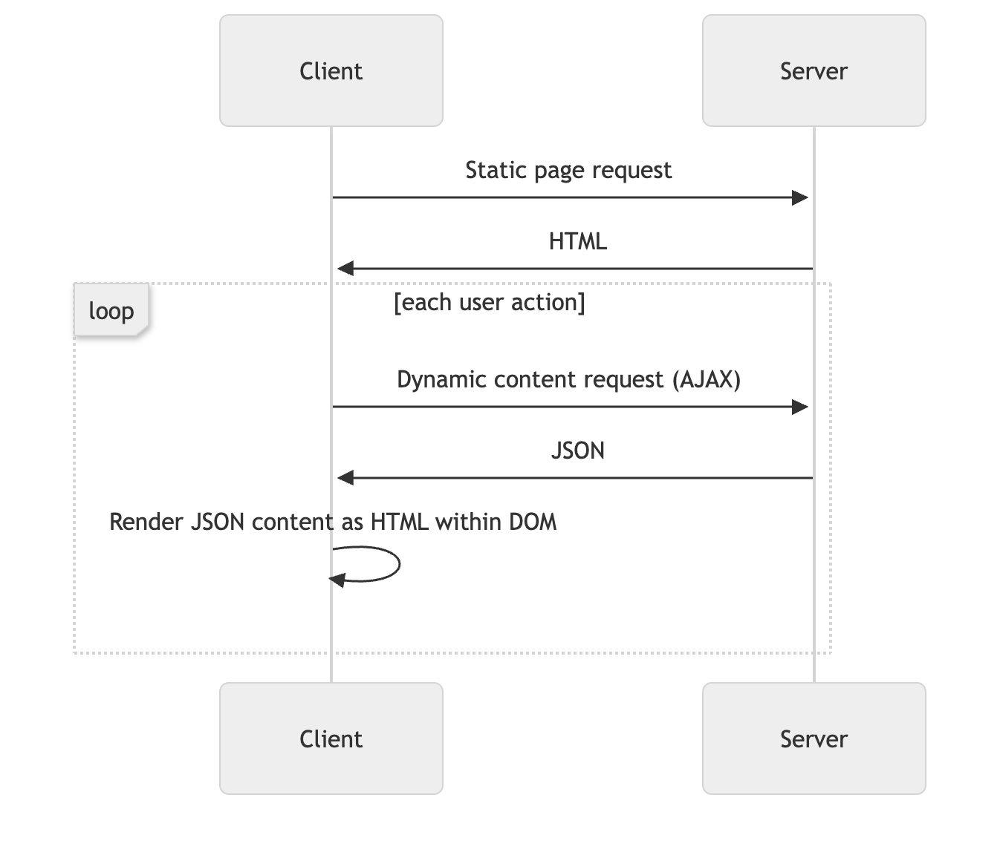

## COMP1101 Programming (Black) Summative Assessment 1 (DRAFT)

## Term 1 Programming Exercise Outline

- Submission of code and video by 14:00 28 January 2027
- Submission of peer reviews by 14:00 18 February 2027
- Return by 25 February 2027
- Contributes 50% of module marks
- Includes peer review feedback which you will be allocated
- This is an individual piece of work

### Subject-specific Knowledge

- Interaction between JavaScript programs and the Document Object Model (DOM)
- Using control statements to loop and make decisions
- An understanding of the nature of imperative programming in the object-oriented style
- A knowledge and understanding of good programming practice (for example, reuse, documentation and style)

- Building collections of data within a program and using JavaScript Object Notation (JSON)
- Making programs robust through the use of exceptions and exception handling

### Subject-Specific Skills

- an ability to realise solutions to problems as working JavaScript programs
- an ability to apply reuse by exploiting predefined components
- an ability to use software tools related to programming (programming environments, code management, documentation tools, etc.)

### Key Skills

- an ability to communicate technical information
- an ability to recognise and apply the principles of abstraction and modelling

## Task summary

- Construct a dynamic web site for an application of your choosing
- Use static HTML pages loading dynamic JSON content from server via AJAX
- Server written in Node.js to provide JSON through REST API
- Prepare a 2 minute video demonstrating your code
- Do a code quality review of four other submissions

### Dynamic web site

- Choose any application domain as long as it includes at least two kinds of entity e.g.
  - pictures
  - people
  - places
  - events
  - comments
- Could be e.g. club, social, health, gallery
- If you are not sure then ask me

### Static HTML loading JSON via AJAX

- 'Single page app': page content loaded as JSON via AJAX
- Can have more than one page e.g. for user and admin
- Should provide clean and simple User Experience (UX)
- Should be responsive i.e. work well on desktop and mobile
- Recommend using front-end framework such as Bootstrap, Foundation
- Use standard HTML, CSS and JavaScript. Non-standard frameworks or languages that replace them, such as React or TypeScript, must not be used

#### Message sequence chart

### Server provides JSON through a REST API

Each entity type (e.g. picture) has 

- GET method to list/search (returns a list of ids and names)
- GET method for individual details (includes details of related entities)
- POST method to add new entity
- Document your API in the style of the [ChatGPT API](https://platform.openai.com/docs/api-reference/)
- see [other good API docs](https://nordicapis.com/5-examples-of-excellent-api-documentation/)

- Response provided as JSON
- Content-Type needs to be correct
- HTTP codes should be appropriate e.g. 200, 400, 401, 403, 404 

### Server written in Node.js

- Use npm to manage all dependencies, with runtime and development dependencies correctly recorded in package.json
- Write Jest test cases: run with `npm test`
- Recommend using Express

## Assessment Criteria

Total of 50 marks

- Client-side functionality (9 marks)
- Client-side quality (9 marks)
- Server-side functionality (9 marks)
- Server-side quality (9 marks)
- Video presentation (9 marks)
- Completion of peer reviews (5 marks)

### Client-side functionality criteria

- User Experience (UX): clean layout and minimal clicks/entry required
- App complexity: entities can be listed, viewed and added
- 'Single page' style: asynchronous updates
- Staff reviewed

### Client-side quality criteria

- Standards compliant (HTML5, CSS and standard JavaScript)
- Responsive to different viewport sizes
- Gracefully handles server disconnection
  - useful error messages
  - recovers on server restart
- Peer reviewed; staff moderated

### Server-side functionality criteria

- More than one entity type, with relationships
- REST API provides each entity with appropriate GET/POST methods
- Installs with `npm install`
- Starts with `npm start`
- Staff reviewed

### Server-side quality criteria

- Successful Jest tests with good coverage (run with `npm test`)
- Testing includes Content-Type and HTTP code
- Completeness of API documentation 
- Peer reviewed; staff moderated

## Video Presentation

- Submit a 2 minute (max) video demonstrating your software
- Include demonstration of how to start the program
- All functionality will be assessed by what is demonstrated in the video
- If it is not demonstrated in the video, you will not get a mark for it
- Quality of video presentation will be marked separately from functionality:
  - Structure; Visual Presentation; Audio explanation
- Lose 10% of presentation marks for every 10 seconds over 2 minutes
- Staff reviewed

## Peer Review Marking

5 marks are awarded for peer reviews

* Completion of all reviews on time
* Professional and helpful reviews
* The average student tends to get about 65%
* 65% is on the good/very good boundary of the [marking conventions](https://www.dur.ac.uk/media/durham-university/governance/programme-regulations/undergraduate/coreregsug.pdf) p15

## How to do the assignment

- Design HTML
- Design web service
- Join with Fetch
- Read the [FAQ](FAQ.md)
